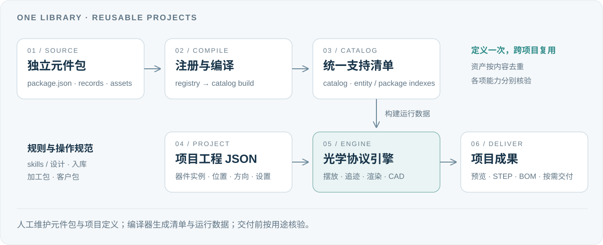

<p align="center">
  
</p>

<h1 align="center">HKSOP · 标准光学协议</h1>

<p align="center">
  <strong>让元件可复用，让布局有依据，让交付可追溯。</strong><br>
  面向模块化实验光路的元件协议、设计引擎与工程工作流
</p>

<p align="center">
  <a href="#overview">项目介绍</a> ·
  <a href="#design">设计思路</a> ·
  <a href="#architecture">系统架构</a> ·
  <a href="#quick-start">快速开始</a> ·
  <a href="#workflows">工作流</a> ·
  <a href="#examples">示例项目</a>
</p>

---

<a id="overview"></a>
## 项目介绍

**HKSOP（Hong Kong Standard Optical Protocol）** 是 ZZLab 面向模块化实验光路建立的工程协议体系。它用结构化 JSON 描述元件、装配接口、真实光学面和项目布局，把元件库、二维光路、光学追迹、三维装配与交付规范连接起来。

一套光路从方案到落地，通常会经历选型、摆放、机械适配、光路检查、采购和加工。HKSOP 的目标是让这些步骤使用一致的元件身份与工程数据：改一个元件时知道影响什么，复用一个模块时知道需要什么，交付一个项目时知道哪些内容已经核验。

| 工作内容 | HKSOP 中的对应能力 |
| --- | --- |
| 定义真实元件 | 登记型号、BOM、机械接口、光学基准、STEP、俯视渲染与能力状态 |
| 组织模块化光路 | 按板孔、安装方向、光高、支撑与碰撞约束摆放器件 |
| 检查光学行为 | 按元件已有交互定义执行追迹；对已实现的情形处理高斯光束变换 |
| 连接二维与三维 | 通过元件身份、坐标与刚性变换关联布局、独立子装配和总装 |
| 组织工程交付 | 按规范整理采购清单、加工包和客户包，并保留各项核验依据 |

**本仓库是供自用的私有精选版**：包含当前标准元件及其依赖、一分三与 DoublePass 示例需要的定制定义，以及三个工程 JSON 示例。元件 STEP 与俯视资源随库提供；三视图、加工图、打标图纸和完整项目交付包暂不收录。

### 当前内容

| 独立元件包 | 物料 / 零件记录 | 可组合套件记录 | 注册板型 |
| :---: | :---: | :---: | :---: |
| **694** | **432** | **263** | **6** |

另含 **584 份去重 STEP**、**376 份俯视资源**和 **3 个项目示例**。统计对应元件版本 `2026-11-09.hksop-github-local-1`；一个包可以包含多条记录，因此包数与记录数不相加。详见[收录范围](docs/selection.json)、[资源清单](docs/asset-manifest.json)与[示例验证记录](docs/example-verification.json)。

<a id="design"></a>
## 设计思路

### 1. 用协议描述元件的工程含义

一个元件应当同时说明“它是什么、怎样安装、光在哪里作用、需要哪些零件”。俯视图用于显示，STEP 用于几何参考；孔位、安装面、真实光学面与交互行为需要明确的数据定义。图形看起来对齐，并不等于机械和光学基准已经一致。

### 2. 按元件包维护，编译成统一清单

每个元件在自己的目录里维护 `package.json`、记录文件和资源。`library/registry.json` 登记正式入库的包，由编译器生成统一支持清单与检索索引。新增元件主要是补齐一个包并通过入库流程，无需手动把所有内容拼进一份越来越大的 JSON。

**因此，支持的元件有统一清单，维护时仍然各自独立。** 未登记的定制草稿可以留在自己的目录里，不会自动成为引擎支持的元件。

### 3. 共用定义与安装变体分开

同一型号的 45°、90° 或不同装配方式，可以共享真正相同的资料，再分别描述安装、摆放和光路差异。型号、零件、套件和实例的身份保持稳定；安装面或真实光学面改变时，需要更新对应协议，不能只旋转图片。

### 4. 项目保存布局，元件库提供定义

项目 JSON 记录所用器件及其位置、方向、板层和光路设置，元件定义与资源集中在库中。多个项目可以复用同一个标准元件；同一份 STEP 或俯视资源按 SHA256 去重保存，避免每个项目、每种角度都复制一份几何文件。

### 5. 按能力分别记录验收

“能显示”“能摆放”“能追迹”“能采购”“能制造”分别记录状态和证据。结构校验通过后，仍需检查真实光高、装配空间、光学基准及交付资料。未知项保留待核验状态，方便使用者判断这个元件目前可以用到哪一步。

<a id="architecture"></a>
## 系统架构

**引擎负责规则与执行，元件库负责定义与资源，项目负责具体布局，skills 负责工作方法与交付要求。**

<p align="center">
  
</p>

```text
HKSOP/
├── hksop.py                         # 统一命令入口
├── engine/                          # 光学协议引擎
│   ├── compiler/                    # 元件包校验、注册、编译与运行目录构建
│   ├── schemas/                     # JSON 结构约定
│   ├── templates/                   # 新元件包模板
│   ├── layout/                      # 摆放、孔位、支撑、碰撞与板层
│   ├── optics/                      # 光学交互与追迹
│   ├── rendering/                   # 图形渲染
│   ├── cad/                         # CAD 与装配辅助
│   ├── exports/                     # BOM 与交付导出
│   └── apps/                        # Web 与编辑器界面
├── library/                         # 当前有效元件库
│   ├── standard/                    # 标准套件
│   ├── components/                  # 共用采购件与制造件
│   ├── modules/                     # 组合模块
│   ├── boards/                      # 当前所需板型
│   ├── custom/                      # 项目所需的定制定义
│   ├── assets/sha256/               # 去重后的 STEP 与俯视资源
│   ├── registry.json               # 正式入库包的登记入口
│   └── catalog.json                # 编译生成的统一支持清单
├── projects/                        # 具体工程 JSON 与示例说明
├── skills/                          # 设计、入库、加工与客户交付规范
├── docs/                            # 架构、命令、范围与验证记录
└── config/                          # 当前副本范围与本机环境配置示例
```

以上为主要目录；通用目录和程序文件采用英文命名，元件及项目的显示名称可以使用中文。更完整的关系见[架构说明](docs/architecture.md)。

### 三类记录与一套索引

| 对象 | 负责描述什么 | 典型内容 |
| --- | --- | --- |
| `components` | 物料和零件 | 厂家器件、转接件、紧固件、采购与制造信息 |
| `kits` | 可选用、可摆放的装配套件 | BOM、接口、光学面、渲染和交互定义 |
| `registeredBoards` | 可用的板型 | 板型身份、真实孔位与修订信息 |
| 项目中的实例 | 一个套件在具体工程中的使用 | 选用的套件、位置、方向和项目设置 |

日常修改以 **`registry.json` 登记的元件包及记录文件**为源。`catalog.json`、`entity-index.json`、`package-index.json`、`index.html` 和运行目录由工具生成，修改后需要重新构建。`library/snapshots/web-current` 是现行兼容索引；名称中的 `snapshots` 不代表这里保存了一套历史元件库。

<a id="quick-start"></a>
## 快速开始

### 1. 获取仓库并准备运行环境

需要有仓库访问权限的 GitHub 账号、Git、Python 3；命令行光学追迹另外使用 Node.js。先配置好账号的 GitHub SSH 访问，再执行：

```bash
git clone git@github.com:ustcredapple-dotcom/HKSOP.git
cd HKSOP

python3 -m venv .venv
source .venv/bin/activate
python -m pip install -r engine/requirements-runtime.txt
```

STEP 以实际文件保存于 Git 中，初次克隆需要下载这些模型。仓库使用相对符号链接复用资源，克隆环境需要正确保留符号链接；以上命令适用于 macOS / Linux。

### 2. 检查元件库并启动编辑器

```bash
python hksop.py catalog check
python hksop.py catalog build
python hksop.py runtime build --profile editor
python hksop.py serve --profile editor --port 18945
```

在浏览器打开 **http://localhost:18945**，导入 `projects/` 下任一示例的 `project.zzoptics.json`。先从基础反射示例熟悉界面，再查看一分三和 DoublePass 的器件组合。

<details>
<summary><strong>可选：三维 / CAD 依赖与本机路径配置</strong></summary>

CAD 相关功能另需 [CAD 依赖](engine/requirements-cad.txt)。可以在独立 Python 环境中安装，再将其解释器路径填写到本机配置的 `cadPython`；普通运行依赖见 [runtime 依赖](engine/requirements-runtime.txt)。

需要指定 Python 或 Node.js 时，将 [配置示例](config/local-environment.example.json) 复制为 `config/local-environment.json`，填写本机实际路径。该文件不提交到 Git。没有本机配置时，命令入口使用当前 Python，命令行追迹从 `PATH` 查找 Node.js。

`runtime/`、`_build/` 和本机配置属于生成内容或机器设置。修改引擎源码、元件定义后，应重新构建相关目录。

</details>

<a id="workflows"></a>
## 工作流

### A · 把一个新元件放进库

**准备独立包 → 描述接口与资源 → 校验 → 暂存检查 → 正式入库 → 在项目中核验。**

1. **建立元件包。** 从[模板](engine/templates/component-package/)起步，或参考最接近的现有套件。分配唯一、稳定的英文 `packageId` 与记录 ID，填写名称、型号、修订号和来源。
2. **补齐真实工程定义。** 登记物料、BOM、安装接口、真实光学面和交互行为。不同安装方式按差异描述；仅有采购信息的元件不需要虚构光学或机械能力。
3. **登记资产。** 为当前 STEP、俯视渲染等文件填写相对路径、运行目标路径与 SHA256。这个精选仓库继续遵循不收录三视图和制造图纸的范围。
4. **记录能力状态。** 分别填写 `display`、`placement`、`simulation`、`procurement`、`manufacturing` 的状态与证据。
5. **运行入库流程。** 先检查包，再暂存并审阅检查结果；通过后采用返回的暂存目录正式入库。

```bash
python hksop.py package check /path/to/new-package
python hksop.py package stage /path/to/new-package --collection custom
python hksop.py package adopt runtime/staging/<stage-id>
```

`<stage-id>` 使用上一步输出的实际值。需要进入标准库时，将 `--collection custom` 改为 `--collection standard`。暂存后如果元件库发生变化，需要重新暂存，再执行正式入库。

6. **重建并实测使用。** 重建目录和编辑器运行数据，在一个具体项目里检查俯视显示、摆放、光轴高度、光路和 BOM。将实际核验结果记入项目日志。

`package check` 检查结构；`package stage` 进一步检查合并后的库契约、BOM 与声明资产。这些检查不能替代实际装配及物理性能验收。完整步骤见[元件入库指南](docs/component-intake.md)与[上传规范](skills/hksop-component-upload/SKILL.md)。

### B · 从元件库搭建一套光路

| 步骤 | 具体工作 | 保留下来的结果 |
| --- | --- | --- |
| 选型 | 确定板型、光高、器件及可用能力，检查依赖 | 所选套件与项目边界 |
| 布局 | 在编辑器中放置、旋转、组合元件，设置光源与光路 | 当前工程 JSON |
| 检查 | 检查孔位、安装空间、真实光学面与已支持的追迹行为 | 问题清单与核验依据 |
| 三维复建 | 使用当前元件 STEP，核对坐标、刚性变换和子装配关系 | 项目需要的当前三维结果 |
| 交付 | 整理采购需求与交付资料；按用途检查完整性 | 采购清单、加工包或客户包 |

项目始终引用当前元件库。设计修改后，重新检查受到影响的光路、机械接口和交付内容，再确认当前最终工程 JSON。

### C · 按用途组织交付

| 交付类型 | 重点 | 对应规范 |
| --- | --- | --- |
| 采购清单 | 型号、数量、来源、采购件与自制件的区分 | 元件记录及 BOM |
| 加工包 | 当前零件、尺寸、公差、材料、表面处理、打标与装配要求 | [加工包规范](skills/hksop-manufacturing-package/SKILL.md) |
| 客户包 | 当前设计、装配信息、使用说明与验收范围 | [客户包规范](skills/hksop-customer-package/SKILL.md) |

本仓库提供协议、工具和流程入口。**要形成可下单加工的完整交付，需要为具体项目补齐并核验图纸与制造信息；仓库中的 STEP 本身不代表加工包已完成。**

<a id="examples"></a>
## 示例项目

| 示例 | 器件实例 | 建议阅读重点 | 工程文件 |
| --- | :---: | --- | --- |
| **基础反射示例** | 1 | 熟悉最小项目、器件实例与编辑器导入 | [打开 JSON](projects/基础反射示例/project.zzoptics.json) |
| **一分三示例** | 18 | 查看多器件组合、分支光路与依赖复用 | [打开 JSON](projects/一分三示例/project.zzoptics.json) |
| **DoublePass 示例** | 12 | 查看往返光路项目及其配套定制定义 | [打开 JSON](projects/DoublePass示例/project.zzoptics.json) |

三个示例已记录通过编辑器工程兼容性检查，详见[示例验证](docs/example-verification.json)。兼容性检查表示工程可按当前协议读取，不等同于全部器件完成实物测试或制造验收。

## 版本与保留规则

- **引擎与元件库**只维护当前有效实现、定义及现用资源；不同现用型号和安装变体可以共存。
- **实际项目**按需要保留当前最终工程与成果；历史仅保留人工确认或正式交付的工程 JSON 里程碑，并按内容去重。
- **历史项目的三维模型、CAD、图纸和整套交付包**不另存；运行缓存和临时暂存不作为永久版本。
- **历史 JSON**用于布局追溯，重新打开时需检查与当前元件库的兼容性。这个精选仓库只带三个当前示例，没有收录项目历史。

详细规则见[保留策略](docs/retention-policy.md)。来源、版本号和验收结论可以作为精简文字记录保留；本机路径、运行数据与项目日志不上传 GitHub。

## 文档入口

| 想做什么 | 从这里开始 |
| --- | --- |
| 理解目录与数据关系 | [架构说明](docs/architecture.md) · [元件库说明](library/README.md) |
| 查询命令 | [命令参考](docs/commands.md) |
| 设计或新增元件 | [设计规范](skills/hksop-component-design/SKILL.md) · [入库指南](docs/component-intake.md) · [包结构 schema](engine/schemas/hksop-package.schema.json) |
| 让助手按本仓库流程工作 | 先读 [HKSOP 上下文](skills/HKSOP_CONTEXT.md)，再读[标准光学协议 skill](skills/hksop-standard-optics/SKILL.md)及对应业务规范 |
| 核对收录内容与资源 | [精选范围](docs/selection.json) · [资源清单](docs/asset-manifest.json) |
| 查看验证依据 | [本地验收说明](docs/verification.md) · [运行验证](docs/runtime-verification.json) · [示例验证](docs/example-verification.json) |

初始筛选与验收记录保留了当时的上传状态；当前 GitHub 发布内容以仓库 `main` 为准。元件数量是所列版本的快照，后续入库后以重新编译的统一清单为准。

---

<p align="center">
  <strong>HKSOP · Hong Kong Standard Optical Protocol</strong><br>
  ZZLab · Modular optics, described with engineering data.
</p>

<p align="center">
  <sub>首页沿用已定稿的 <a href="skills/zzlab-modular-optics/assets/standard-optics-logo/hksop-logo-mono.svg">HKSOP 矢量标识</a>，保留原始字形与比例。封面线条为示意图。</sub>
</p>
