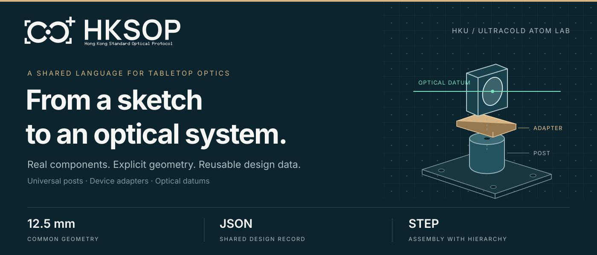
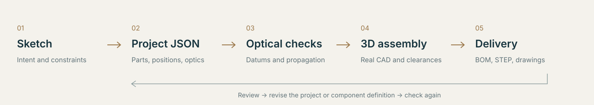
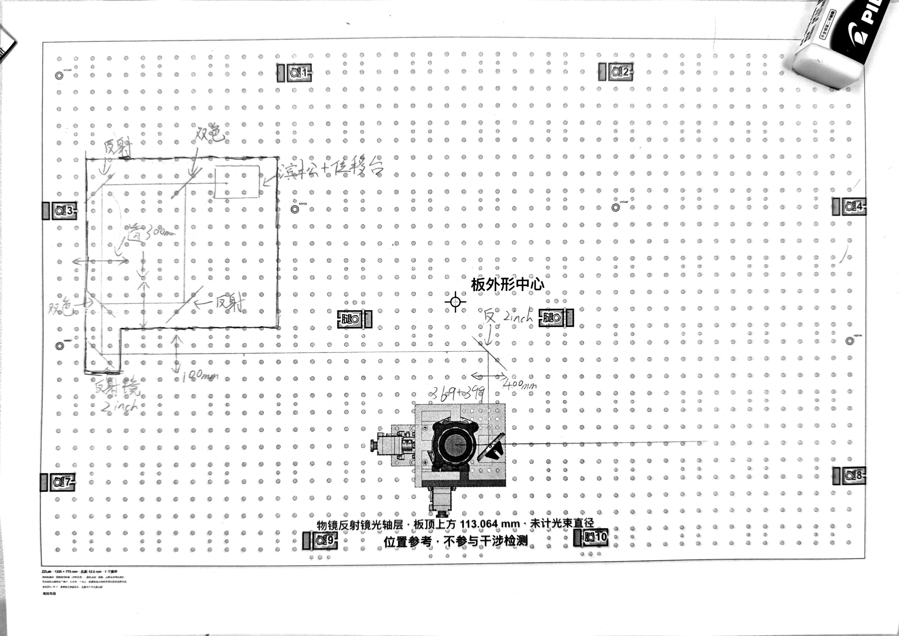
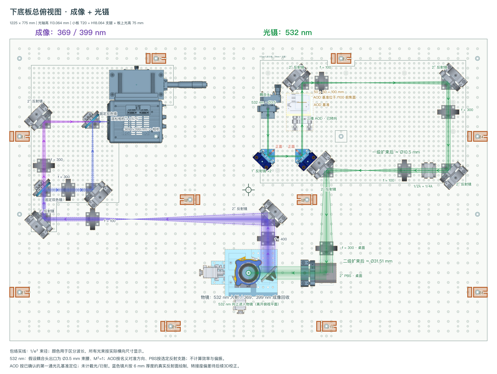
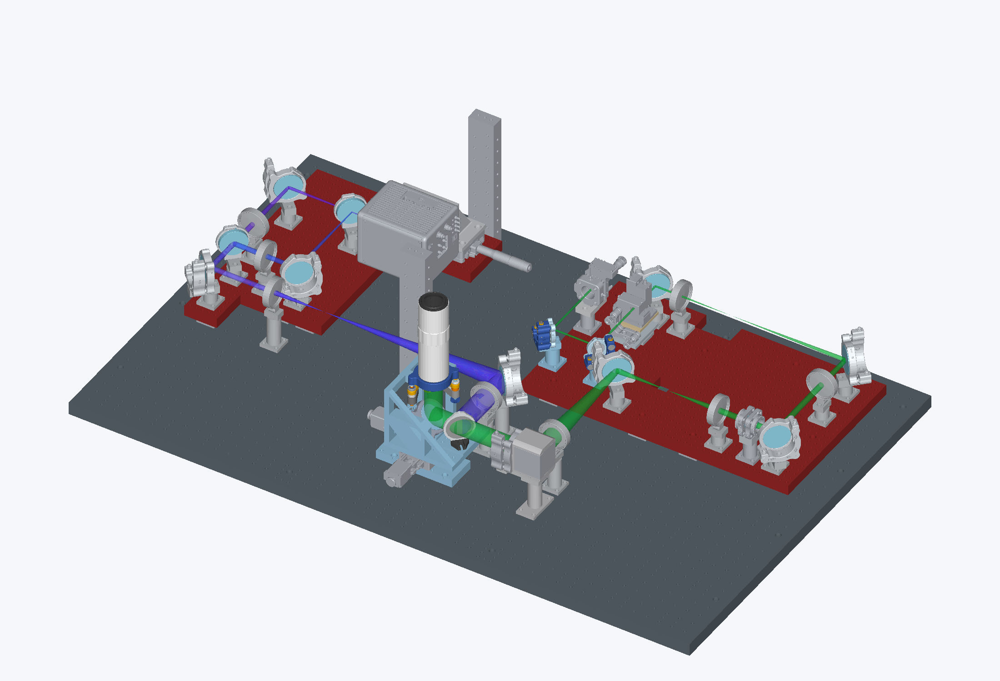
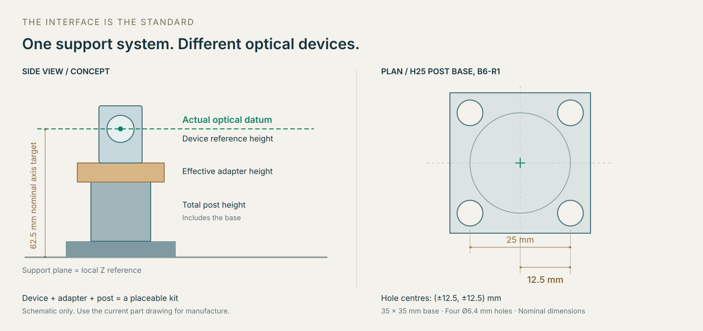
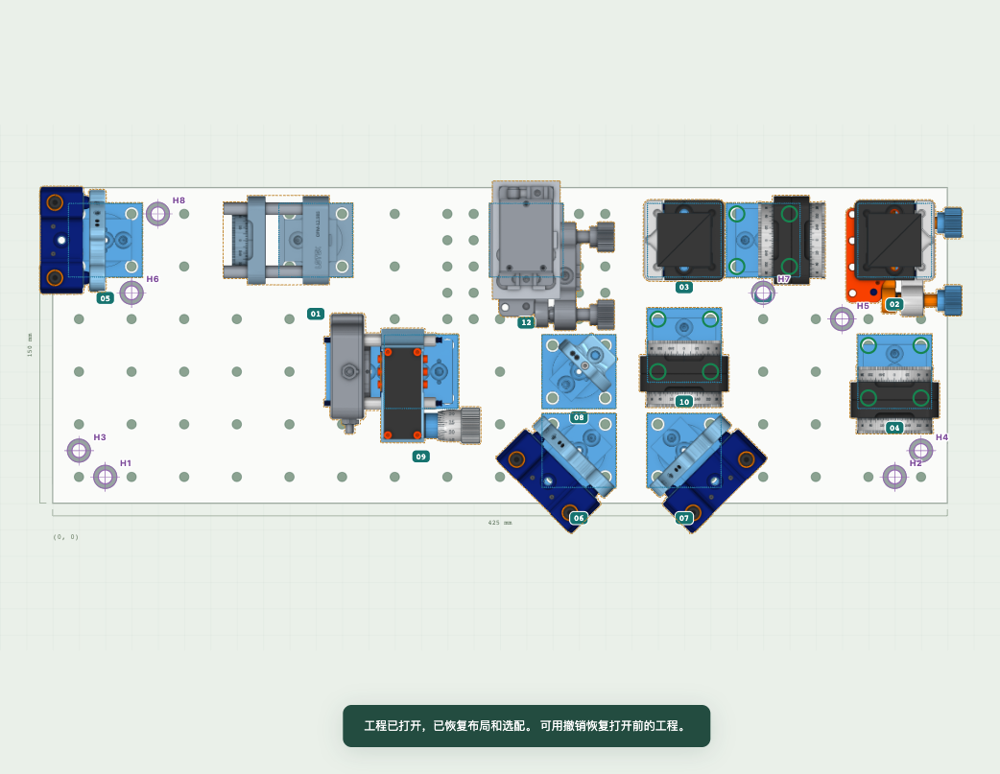
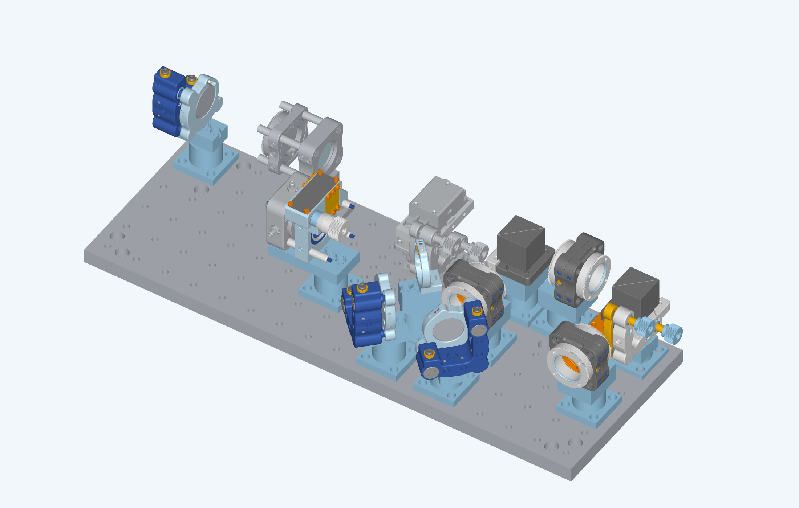

<p align="center">
  
</p>

<h1 align="center">HKSOP · Hong Kong Standard Optical Protocol</h1>

<h3 align="center">Building an AI-native experimental system!</h3>

<p align="center">A common mechanical interface and a machine-readable design workflow for tabletop optics.</p>

<p align="center">
  <a href="#overview">Overview</a> ·
  <a href="#sketch-to-3d">Sketch to 3D</a> ·
  <a href="#mechanical-system">Posts &amp; Adapters</a> ·
  <a href="#standard">Why 12.5 mm?</a> ·
  <a href="#quick-start">Quick Start</a> ·
  <a href="#documentation">Documentation</a>
</p>

<p align="center">
  <a href="https://www.ultracold.hku.hk/">HKU Ultracold Atom Lab · ZZLab</a> ·
  <a href="mailto:u3013215@connect.hku.hk">Wang Junjie</a>
</p>

<a id="overview"></a>
## 从实验想法到可复用的设计 / From an idea to a reusable design

HKSOP 的设计来自**香港大学 HKU Ultracold Atom Lab（ZZLab）**。我们在搭光路时反复遇到同一个问题：手稿表达了实验想法，二维图摆好了元件，三维模型却仍要重新拼装；改一个镜架，光学面、转接件、支撑高度和采购清单都可能跟着变。

这套协议把这些关系明确下来。机械上，万能柱提供可复用的支撑和定位接口，转接件把不同厂家的器件接到同一体系。数据上，元件包描述真实孔位、光学基准和 CAD，项目 JSON 描述这一次实验怎样使用它们。人和 AI 可以沿着同一份工程定义完成布局、光路检查、三维复建和交付。

HKSOP was developed at the **HKU Ultracold Atom Lab (ZZLab), The University of Hong Kong**. A sketch captures the experimental idea, but translating it into a layout, a CAD assembly and a parts list often means entering the same decisions several times. Changing one mount can affect the optical datum, adapter, support height and purchasing list.

HKSOP makes those relationships explicit. Universal posts provide reusable support and locating interfaces; device-specific adapters connect different commercial components to that system. Component packages describe real mounting geometry, optical datums and CAD. Project JSON describes how those components are used in an experiment. People and AI can work from that shared definition through layout, optical checks, 3D reconstruction and delivery.

<details>
<summary><strong>当前仓库收录范围 / What is included</strong></summary>

当前精选库有 **695 个包**：现用 **438 条零件、265 条套件和 6 种底板**；另有 **288 条冻结历史定义**，供旧工程继续解析和显示，不支持新增拖入。共享资源含 **598 份 STEP、386 份渲染资源、548 份 PDF 和 357 份 DXF**。项目目录保留三个可导入示例。当前资料版本为 `2026-11-12.hksop-history-r1`。

The curated library contains **695 packages**, with **438 active components, 265 active kits and 6 board definitions**, plus **288 frozen historical definitions** for existing designs. Historical entries can render but cannot be newly placed. Shared resources include **598 STEP files, 386 rendering resources, 548 PDFs and 357 DXFs**. The three importable examples remain available.

现用元件图纸随库提供，修订与原有验收状态保持不变。下文成像项目的图片用于说明实际工作过程；它的完整定制依赖和三维总装没有因此加入精选库。文件范围见[收录清单](docs/selection.json)、[元件资源清单](docs/asset-manifest.json)和[首页图片来源](docs/assets/sources.json)。

Current component drawings retain their original revisions and verification states. The imaging-project images below illustrate a real workflow; its full custom dependency set and assembly are not added to the curated library. See the [selection](docs/selection.json), [component asset manifest](docs/asset-manifest.json) and [homepage image sources](docs/assets/sources.json) for the scope.

</details>

<a id="sketch-to-3d"></a>
## 手稿 → JSON → 三维总装 / From sketch to 3D



### 先把想法说清楚 / Start with the experimental intent

下面的手稿来自实际的**成像及光镊**项目。最初只画了左侧成像光路：在哪块小板上放镜架、光从哪里来、怎样分到相机，以及各片透镜的焦距。把手稿变成工程数据时，先确认元件型号、镜面正反、波长和关键距离，再映射到库中已有的套件。这个项目里，手写的小板入口透镜曾被读成 f=180 mm，经用户确认后改为 **f=100 mm**。这一步需要理解和确认实验意图。

The sketch below comes from the **imaging and optical-tweezers project**. It initially described the imaging path on the left: the sub-board, mirrors, camera branches and focal lengths. Before creating the project, the component choices, reflecting faces, wavelengths and critical distances were resolved and mapped to registered kits. One handwritten focal length was initially read as 180 mm; the user clarified that it was **100 mm**. Interpreting and reviewing the design is part of the workflow.

<p align="center">
  <a href="docs/assets/imaging-hand-sketch.jpg"></a>
  <a href="docs/assets/imaging-tweezers-layout-r10.png"></a>
</p>

*左：最初的成像手稿。右：后来加入右侧 532 nm 光镊支路的 R10 布局。点击图片查看细节。 / Left: the initial imaging sketch. Right: the later R10 layout, with the 532 nm tweezers path added on the right. Open either image for detail.*

### 用 JSON 留下可继续修改的设计 / Make the design explicit in JSON

JSON 保存的是器件实例和工程关系：使用哪个套件、属于哪块板、相对板原点的位置、转角、选用的万能柱，以及光源和光学设置。比如下面这条记录来自 R10：同一个一英寸镜架套件安装在右侧小板上，位置为板内 `(25, 75) mm`、转角为 `90°`，支撑从 25 mm 柱换成 37.5 mm 柱。它的世界坐标还要经过小板的位置与姿态变换。这里展示的是**实例字段摘录**，完整工程还需要板定义、光学配置和对应元件库。

JSON records the kit, parent board, local position, orientation, selected post and optical configuration of each instance. This excerpt from R10 places a one-inch mirror kit at `(25, 75) mm` on the right-hand sub-board, rotates it by `90°`, and substitutes a 37.5 mm post for the 25 mm post. The board transform then determines its world position. This is an **instance excerpt**; a complete project also needs the board, optical settings and matching library.

```json
{
  "id": "R-M1-1inch",
  "kitId": "adjustable-1-45",
  "boardId": "right532-subboard",
  "xMm": 25.0,
  "yMm": 75,
  "rotationDeg": 90,
  "universalPostSelection": {
    "custom-post-metric-25mm-m1": "custom-post-metric-37p5mm-m1"
  }
}
```

在二维阶段，既检查实际安装孔能否落到板孔上，也检查光线是否从正确的光学面入射、透镜间距是否满足设计。成像路径的 f400/f100 透镜间折叠光程调整为 **500 mm**；右侧 AOD 的已确认参考点到 f100 透镜调整为 **100 mm**。光束包络使用记录下来的假设：例如 532 nm 入射束腰直径 3.5 mm、M²=1；这张图没有计算 AOD 衍射效率和截光，AOD 的实际晶体作用面也未被确认为已知基准。

The 2D review checks actual mounting holes, the illuminated side of each optical surface and the intended optical distances. The imaging f400/f100 pair was adjusted to a **500 mm** folded separation; the agreed AOD reference was placed **100 mm** from the following f100 lens. Beam envelopes use recorded assumptions, including a 3.5 mm input waist diameter and M²=1 for 532 nm. This rendering does not model AOD diffraction efficiency or clipping, and the crystal interaction plane was not established as a known datum.

### 用真实几何检查装不装得下 / Rebuild and inspect the real assembly

三维阶段把现有器件、转接件、万能柱和紧固件组成独立子装配，再按 JSON 与板层变换放入总装。下面是随后完成的 **R11 下板总装**。右侧模块采用 20 mm 小板、18.064 mm 支腿和板上 75 mm 光高，合计为相对下板顶面的 **113.064 mm**。这个高度来自实际系统接口，并没有被强行取整到 12.5 mm。

In 3D, the existing device, adapter, post and fasteners form a kit sub-assembly, which is placed using the project and board transforms. The subsequent **R11 lower-board assembly** is shown below. Its right-hand module combines a 20 mm board, 18.064 mm legs and a 75 mm optical height above that board, giving **113.064 mm** above the lower-board surface. That height follows the actual system interface; it is not rounded to a 12.5 mm multiple.



三维核对还发现了二维图没有充分暴露的问题：小板缺口要加深，一条支腿要移开框架立柱，两片蓝色镜片需要约 **0.813 mm** 的补偿垫环，让真实反射面回到指定基准。修正后再核对孔位、光高、实体干涉和装配层级。这个过程会把发现的问题带回项目或元件定义，形成下一次可复建的版本。

The CAD review exposed details that were not fully apparent in the layout: a deeper board cutout, a leg moved clear of a frame column, and approximately **0.813 mm** compensation spacers at two blue mirror mounts to bring the real reflecting surfaces back to their intended datums. Mounting holes, optical heights, solid interference and assembly hierarchy were checked after those changes. Findings feed back into the project or component definition for the next rebuild.

这是一条已经实际使用的人与 AI 协作流程。当前仓库提供协议、编辑器、库和复建工具；具体 CAD 复建仍要适配项目支持的套件与板层。图中模型是静态工程装配，不代表机构运动、所有光学参数或加工放行均已完成。详细过程与图片阶段见[案例说明](docs/workflow-case-study.md)。

This is an engineering workflow used by people working with AI. The repository provides the protocol, editor, library and reconstruction tools; CAD rebuilds still need a project-compatible set of kits and board transforms. The result shown is a static engineering assembly, with its recorded limits on mechanism motion, optical parameters and manufacturing approval. See the [case study](docs/workflow-case-study.en.md) for the stages and evidence.


<a id="mechanical-system"></a>
## 万能柱与转接件体系 / Universal posts and adapters

万能柱负责可重复使用的下半部分：底座与板孔连接，柱体确定支撑高度，顶面接口连接转接件。转接件负责器件特有的上半部分：接住厂家原有安装面，把真实光学中心、反射面或透射轴带到协议要求的位置。镜架、PBS、波片架、AOD 或相机保留自己的实际尺寸，通过不同转接件进入同一套装配体系。

这样，新增器件时可以沿用已有柱和底座接口，把设计工作集中到确实不同的连接处。一个可摆放的 `kit` 包含器件、转接件、支撑及所需紧固件，并声明安装孔、光学基准、外形和 BOM。45° 与 90° 安装变体要分别描述自己的几何；只有确实共用的零件才共用记录。

A universal post supplies the reusable lower interface: a base fixed to the board, a defined support height, and a top interface for the adapter. The adapter handles the device-specific connection and brings the actual optical centre, reflecting surface or transmission axis to the required datum. Mirror mounts, PBS holders, waveplates, AODs and cameras keep their real dimensions and join the system through their own adapters.

Adding a device can therefore reuse the established post and board interface, while concentrating new design work on the connection that differs. A placeable `kit` describes the device, adapter, support and required fasteners, together with mounting holes, optical datums, envelope and BOM. The 45° and 90° mounting variants each describe their own geometry and share only the parts that are actually identical.



常用标准光高为相对相应支撑平面的 **62.5 mm**。当前万能柱标准系列为 **12.5、25、37.5…150 mm**；柱高已经包含底座。转接件补齐器件安装面到真实光学基准之间的差值，其有效高度可以不是 12.5 mm 的整数倍。多层系统还要加上板厚和支腿等明确的支撑高度。定位销负责所设计的定位约束，螺钉提供夹紧；最终能否可靠装配仍取决于实际孔、公差、接触面和操作空间。

The usual nominal optical height is **62.5 mm above the relevant support plane**. The current standard post series is **12.5, 25, 37.5 … 150 mm**, with the base included in the stated height. The adapter compensates for the device's actual mounting-to-optical-datum distance; its effective height need not be a multiple of 12.5 mm. Multi-level assemblies also account for board and leg heights. Locating pins provide their designed constraints and screws provide clamping; fit depends on the actual holes, tolerances, contact surfaces and access.

<a id="standard"></a>
## 为什么是标准协议：12.5 mm 定位机制 / What makes it standard?

这里的“标准”指一套共同遵守的工程约定：单位、坐标原点、安装孔、光学基准、支撑高度和安装方向都有明确含义。**12.5 mm 是这个体系常用的几何模数**。常规板的 12.5 mm 或 25 mm 孔距、以 12.5 mm 递增的柱高，以及明确的套件孔位，使不同器件可以在同一布局中组合，也让程序能够判断一个摆法是否成立。

以上图的 25 mm 万能柱底座为例，底座外形为 35 × 35 mm，四个安装孔构成 **25 × 25 mm** 的方阵。以柱轴为局部原点，孔中心就是 **(±12.5, ±12.5) mm**。对应的可调反射镜套件把光学中心定义在这个原点上方 62.5 mm，转接件负责实现这一关系。把套件移到另一处或旋转后，程序应变换这四个真实孔位，核对它们与目标板孔的重合关系。仅把图标中心吸到网格上，并不能证明可以固定。

底板自己的原点和孔阵偏移同样重要。常规网格按 `edgeOffsetMm + index × pitchMm` 定位；异形板和已登记底板以真实的 `holesMm` 孔表为准。孔表里没有的孔，不能因为 `pitchMm` 写了 12.5 就推定存在。特殊光高、偏置底座和自定义转接件可以纳入体系，但必须把实际尺寸、变换和适用范围写清楚。**12.5 mm 表示设计规则，不表示定位精度，也不是国际认证。**

“Standard” means a shared engineering contract: units, coordinate origins, mounting holes, optical datums, support heights and allowed configurations have defined meanings. **12.5 mm is a common geometric module**. The 12.5 mm or 25 mm pitches of supported regular boards, the 12.5 mm post-height increments and explicit kit mounting patterns make components composable and placements checkable.

For the H25 post shown above, a 35 × 35 mm base carries a **25 × 25 mm** mounting-hole square. Relative to the post axis, the hole centres are **(±12.5, ±12.5) mm**. The corresponding adjustable-mirror kit defines its optical centre 62.5 mm above that origin, with the adapter establishing the relationship. A translated or rotated kit must bring those actual transformed holes onto compatible board holes. Snapping the icon centre to a grid alone does not establish a mountable placement.

Board origins and grid offsets matter too. A regular grid uses `edgeOffsetMm + index × pitchMm`; registered and custom boards use their actual `holesMm` definitions. Declaring a 12.5 mm pitch does not create holes absent from that map. Special heights, offset bases and custom adapters can fit the same protocol when their real dimensions and transforms are explicit. **The 12.5 mm module is a design convention, not a positioning tolerance or an international certification.**

这些关系可以直接追溯到[万能柱记录](library/components/custom-post-metric-25mm-m1/records/custom-post-metric-25mm-m1.json)、[可调反射镜套件](library/standard/adjustable/adjustable-1/records/adjustable-1-45.json)和[孔位对齐实现](engine/layout/javascript/web/layout.js)。 / These relationships are recorded in the [post definition](library/components/custom-post-metric-25mm-m1/records/custom-post-metric-25mm-m1.json), [mirror kit](library/standard/adjustable/adjustable-1/records/adjustable-1-45.json) and [mounting-alignment implementation](engine/layout/javascript/web/layout.js).

<a id="design"></a>
## 同一份定义，贯穿整个工程 / One definition through the project

元件库与项目承担不同工作。元件包维护型号、机械接口、光学行为、采购组成和当前模型；`library/registry.json` 决定哪些包进入正式清单，编译器再生成 catalog 与索引。新元件主要维护自己的包，其他项目继续引用稳定 ID。项目 JSON 保存实例和实验设置，大型 STEP、俯视图与图纸按内容哈希共享。

二维图片、光学计算与三维几何也有各自的依据。图片负责展示，光学规则描述支持的相互作用，CAD 提供真实实体；三者通过明确的基准和变换对应。三维复建保留“零件 → 套件子装配 → 项目实例”的层级。不同用途分别记录 `display`、`placement`、`simulation`、`procurement` 和 `manufacturing` 的状态与证据，避免把“能显示”当作“可以加工”。

The library owns part numbers, mechanical interfaces, optical behavior, BOM composition and current assets. `library/registry.json` selects the supported packages, and the compiler generates the shared catalog and indexes. New devices are maintained in their own packages while projects reference stable IDs. Project JSON stores instances and experimental settings; large STEP files, views and drawings are shared by content hash.

Display assets, optical rules and CAD serve distinct roles and are connected through explicit datums and transforms. The 3D workflow preserves the hierarchy from parts to kit sub-assemblies to project occurrences. Readiness and evidence are recorded separately for `display`, `placement`, `simulation`, `procurement` and `manufacturing`, so a viewable model does not imply a manufacturing release.

<a id="quick-start"></a>
## 快速上手 / Quick Start

仓库使用相对符号链接共享资源，以下步骤适用于 macOS 或 Linux，克隆时需要保留这些链接。准备好 Git 和 Python 3；公开仓库可通过 HTTPS 克隆，无需 GitHub 登录。命令行光学追迹另外需要 Node.js。

The repository uses relative symlinks for shared assets. The commands below target macOS or Linux with symlink support, Git, and Python 3. You can clone the public repository over HTTPS without a GitHub account. Node.js is also needed for CLI optical tracing.

**下载并安装依赖 / Clone and install**

```bash
git clone https://github.com/ustcredapple-dotcom/HKSOP.git
cd HKSOP

python3 -m venv .venv
source .venv/bin/activate
python -m pip install -r engine/requirements-runtime.txt
```

**生成总表并启动编辑器 / Build and launch**

```bash
python hksop.py catalog check
python hksop.py catalog build
python hksop.py runtime build --profile editor
python hksop.py serve --profile editor --port 18945
```

启动后，用浏览器打开 **[http://localhost:18945](http://localhost:18945)**，导入 `projects/` 下示例目录中的 `project.zzoptics.json`。第一次可以先用基础反射示例熟悉导入、拖动和旋转，再看一分三与 DoublePass 的组合布局。

Open **[http://localhost:18945](http://localhost:18945)** and import a `project.zzoptics.json` from `projects/`. Start with Basic Reflection to try importing and manipulating a kit, then explore the larger 1-to-3 and DoublePass layouts.

<details>
<summary><strong>可选：三维 CAD 环境与本机路径 / Optional: CAD environment and local paths</strong></summary>

三维 CAD 功能另外使用 [CAD 依赖](engine/requirements-cad.txt)。可以在独立 Python 环境中安装，再将[配置模板](config/local-environment.example.json)复制为 `config/local-environment.json`，把解释器路径填入 `cadPython`。同一配置也可以指定运行时 Python 和 Node.js；未配置时，使用当前 Python，命令行追迹从 `PATH` 查找 Node.js。本机配置不提交到 Git。

CAD operations require the [CAD dependencies](engine/requirements-cad.txt). Install them in a separate Python environment if needed, copy the [configuration template](config/local-environment.example.json) to `config/local-environment.json`, and set `cadPython` to that interpreter. You can also specify the runtime Python and Node.js paths. Defaults use the current Python and Node.js from `PATH`; the local configuration is ignored by Git.

</details>

<a id="layout"></a>
## 目录说明 / Repository Tour

仓库把软件、元件和具体工程分开维护。`engine/` 负责校验、摆放、光路计算、渲染、CAD 辅助和界面；`library/` 保存当前元件定义及资源；`projects/` 放示例工程；`skills/` 和 `docs/` 提供操作规范与说明。各主要目录的说明提供英文入口。

The repository separates software, component definitions, and project layouts. `engine/` contains validation, layout, optics, rendering, CAD helpers, and applications; `library/` holds the current definitions and assets; `projects/` contains example layouts; and `skills/` and `docs/` contain workflows and documentation. Directory guides include English versions.

```text
HKSOP/
├── hksop.py                         # 命令行入口 / Main CLI
├── engine/                          # 校验、布局、光学与 CAD / Software engine
├── library/                         # 现用元件及历史依赖 / Active components and history
│   ├── standard/                    # 标准装配套件 / Standard kits
│   ├── components/                  # 采购件与自制件 / Purchased and machined parts
│   ├── modules/                     # 组合模块 / Composite modules
│   ├── boards/                      # 底板与孔位 / Boards and hole patterns
│   ├── custom/                      # 项目定制定义 / Project-specific definitions
│   ├── assets/sha256/               # 模型、俯视图与图纸 / Models, views and drawings
│   ├── registry.json               # 已登记的包 / Registered source packages
│   └── catalog.json                # 自动生成的总表 / Generated catalog
├── projects/                        # 示例光路 / Example layouts
├── skills/                          # 设计、入库与交付规范 / Engineering workflows
├── docs/                            # 说明与验证记录 / Documentation and verification
└── config/                          # 范围及本机配置 / Scope and local configuration
```

库里的 `components` 是单独采购或加工的零件，例如镜架、接杆和转接件；`kits` 是由这些零件组成、可以在编辑器里摆放的装配单元；`registeredBoards` 描述底板的真实外形、孔位和修订。项目中的实例则记录某个套件在这次工程里的位置、方向和设置。

平时修改元件，以各包的记录文件和 `registry.json` 为源。`catalog.json`、各类索引、HTML 目录和 `runtime/` 是构建结果，改完源文件后重新生成即可。`library/snapshots/web-current` 是当前兼容索引，不是历史元件库备份。

In the library, `components` are individual purchased or machined parts, `kits` are placeable assemblies, and `registeredBoards` define board geometry, mounting holes, and revisions. Project instances describe where a kit is used and how it is configured in a particular layout. Edit the package records and registry, then rebuild the generated catalog, indexes, and runtime. `library/snapshots/web-current` is the current compatibility index, not a historical library archive.

<a id="workflows"></a>
## 日常维护与交付 / Maintaining and delivering a design

### 添加新元件 / Adding a component

买了新器件或完成新的转接件设计后，可以从 [元件包模板](engine/templates/component-package/)起步，或参考最接近的现有套件。为新包和记录分配唯一、稳定的英文 ID，填写型号、来源、BOM，以及实际已有的机械和光学数据。采购零件不必虚构套件几何；需要在编辑器中摆放的套件，则要说明安装孔位、光学基准和交互规则。

把当前模型、俯视图和适用图纸登记到包中，写明相对路径、运行目标路径与 SHA256，并分别记录五项能力的状态和证据。随后运行下面三条命令。通用标准包将第二条命令中的 `custom` 改为 `standard`，第三条中的 `<stage-id>` 使用上一步返回的实际名称；暂存期间库有变化时，要重新执行 stage。

Start from the [package template](engine/templates/component-package/README.en.md) or a similar kit, assign stable English IDs, and describe the part numbers, sources, BOM, and available engineering data. A purchasing record does not need invented geometry; a placeable kit needs mounting geometry, optical datums, and interaction rules. Register the current assets with relative paths, runtime targets, and SHA256 hashes, then record the five readiness states with evidence. Use `standard` instead of `custom` for standard packages, replace `<stage-id>` with the returned value, and stage again if the library changes before adoption.

```bash
python hksop.py package check /path/to/new-package
python hksop.py package stage /path/to/new-package --collection custom
python hksop.py package adopt runtime/staging/<stage-id>
```

合入后重建 catalog 和 runtime，在实际项目里检查俯视图、安装孔、光轴高度、追迹与 BOM，并记录结果。包检查和暂存检查可以发现结构、全库契约、BOM 或声明资产的问题，不能替代几何核验与实物装配。详细步骤见[元件入库指南](docs/component-intake.md)和[上传规范](skills/hksop-component-upload/SKILL.md)。

After adoption, rebuild the catalog and runtime and verify the package in a project. Check the top view, mounting holes, optical axis height, supported tracing, and BOM output. Package checks cover structure, catalog contracts, BOM references, and declared assets; they do not certify physical fit. See the [onboarding guide](docs/component-intake.en.md) and [upload workflow guide](skills/hksop-component-upload/README.en.md).

### 从核对到交付 / From review to delivery

布局与三维核对完成后，从当前 BOM 整理采购型号、数量和来源。自制件的加工包还需要同一修订的模型、工程图、孔与螺纹标注、材料、表面处理和打标要求；按[加工包规范](skills/hksop-manufacturing-package/SKILL.md)或[客户包规范](skills/hksop-customer-package/SKILL.md)核对。STEP 给出几何，制造所需的完整要求与放行状态仍需在交付包中明确。

After layout and CAD review, use the current BOM for purchasing quantities and sources. Custom parts also need matching revisions of models and drawings, hole and thread callouts, materials, finishes and marking instructions. Follow the [manufacturing](skills/hksop-manufacturing-package/README.en.md) or [customer delivery](skills/hksop-customer-package/README.en.md) workflow. STEP supplies geometry; the delivery package must also state the manufacturing requirements and release status.

<a id="examples"></a>
## 示例光路 / Example Setups

[基础反射示例](projects/基础反射示例/project.zzoptics.json)含一个可调反射镜架实例，用来熟悉工程结构和编辑器操作；它没有配置光源，是最小摆放示例。[一分三示例](projects/一分三示例/project.zzoptics.json)含 18 个实例，展示分支光路中多个标准套件的组合。[DoublePass 示例](projects/DoublePass示例/project.zzoptics.json)含 12 个实例，展示往返光路和项目定制套件的使用。

三个工程均有当前编辑器的兼容性检查记录，详见[示例验证](docs/example-verification.json)。各项目目录保留来源和适配说明，原有的物理与制造验收范围不因作为示例而改变。

[Basic Reflection](projects/基础反射示例/README.en.md) contains one adjustable mirror-mount instance for learning the project format and editor controls; it has no configured light source. [1-to-3](projects/一分三示例/README.en.md) uses 18 instances to demonstrate a branching layout. [DoublePass](projects/DoublePass示例/README.en.md) uses 12 instances, including project-specific custom definitions. All three have editor compatibility check records; their original physical and manufacturing acceptance limits remain unchanged.

### DoublePass：从摆放到装配 / From placement to assembly

下面两张真实资料来自 DoublePass 手动镜架 **R8**：左侧是编辑器中的布局，右侧是对应的三维总装。不同镜架、PBS、透镜和波片支撑共用这套柱与转接件体系，也保留各自的结构。图片展示这一修订的工作成果，不代表后续改版。

These images show the manual-mount **R8** DoublePass configuration: the editor layout on the left and its CAD assembly on the right. Different mirrors, PBS holders, lenses and waveplate supports use the common post-and-adapter system while retaining their own geometry. The images document this revision rather than later redesigns.

<p align="center">
  <a href="docs/assets/double-pass-layout-r8.png"></a>
  <a href="docs/assets/double-pass-assembly-r8.png"></a>
</p>

## 文件管理约定 / File and Version Rules

引擎维护当前有效代码；元件库维护现用定义，并在 `library/history` 保留旧设计依赖的版本和资料。历史实例仍可渲染，历史元件不进入新建拖入列表。不同现用型号和安装变体可以并存。当前元件的 STEP、俯视图和配套图纸属于正式库资源；项目按需要保留当前最终成果，历史只保留人工确认或正式交付的工程 JSON 里程碑，并按内容去重。

这个仓库只放三个当前示例，不附无依赖的历史项目整套总装或旧交付包；旧设计依赖的元件 CAD、图纸及配套资料随 `library/history` 保留。`runtime/`、构建缓存、项目日志和 `config/local-environment.json` 留在本机。历史 JSON 再打开时按原版本身份解析并检查历史依赖。完整规则见[保留策略](docs/retention-policy.md)。

The engine retains active code; the library keeps active components and old-design dependencies in `library/history`. Historical instances remain renderable, but historical components are unavailable for new placement. Active mounting variants can coexist. Projects retain their current deliverables as needed; historical retention is limited to deduplicated, confirmed engineering JSON milestones. This repository includes three current examples, without unrelated full historical project deliveries; required historical component CAD, drawings and supporting files are retained. Runtime data, build caches, local logs, and machine configuration are not committed. Historical JSON files must resolve their original version identities and dependencies when reopened; see the [retention policy](docs/retention-policy.en.md).

<a id="documentation"></a>
## 继续阅读 / Documentation

实际设计过程见[手稿到三维案例](docs/workflow-case-study.md)，文件与数据关系见[架构说明](docs/architecture.md)、[元件库说明](library/README.md)和[命令参考](docs/commands.md)。新增元件时结合[设计规范](skills/hksop-component-design/SKILL.md)、[入库指南](docs/component-intake.md)和[包 schema](engine/schemas/hksop-package.schema.json)。让 AI 助手参与前，先读 [HKSOP 上下文](skills/HKSOP_CONTEXT.md)与[标准光学协议](skills/hksop-standard-optics/SKILL.md)。

English documentation includes the [sketch-to-3D case study](docs/workflow-case-study.en.md), [architecture](docs/architecture.en.md), [library](library/README.en.md), [CLI](docs/commands.en.md) and [component onboarding](docs/component-intake.en.md) guides. The [skills guide](skills/README.en.md) explains the design and delivery workflows, and the [documentation index](docs/README.en.md) links to verification records. Build the current catalog from source packages; the generated `catalog.json` is not tracked in Git.

### AI 自动设计倒 C 角 / AI design chamfers

自制加工件普通外露非功能锐边和间隙孔外孔口默认 **C0.3×45°**；定位、配合及薄壁处单独判断。倒角须进入实际 CAD/STEP，并与加工图一致；见 [倒 C 角协议](skills/zzlab-modular-optics/references/design-rules.md#chamfer-protocol)。

For custom machined parts, use **C0.3 × 45°** for ordinary exposed non-functional sharp edges and clearance-hole mouths where material permits. Assess functional edges, fits and thin sections individually. Model the accepted chamfers in CAD/STEP and match the drawings; see the [chamfer protocol](skills/zzlab-modular-optics/references/design-rules.md#chamfer-protocol).

## 来源与联系 / Origin and Contact

本项目的设计来自**香港大学 HKU Ultracold Atom Lab（ZZLab）**。实验室网页为 [Ultracold@HKU](https://www.ultracold.hku.hk/)。项目联系 **Wang Junjie**，邮箱 [u3013215@connect.hku.hk](mailto:u3013215@connect.hku.hk)，GitHub 为 [ustcredapple-dotcom](https://github.com/ustcredapple-dotcom)。

This design comes from the **HKU Ultracold Atom Lab (ZZLab), The University of Hong Kong**. Visit [Ultracold@HKU](https://www.ultracold.hku.hk/) for the lab website. For this project, contact **Wang Junjie** at [u3013215@connect.hku.hk](mailto:u3013215@connect.hku.hk) or through [ustcredapple-dotcom](https://github.com/ustcredapple-dotcom).

<a id="contributors"></a>
## Contributors

**[Wang Junjie](https://github.com/ustcredapple-dotcom)** 负责项目方向、实验需求、光学与机械设计，以及工程审核。**[ChatGPT](https://chatgpt.com/)** 作为 **AI 协作助手**，参与协议整理、代码与文档编写、光路 JSON 布局和三维复建辅助，并协助整理验证记录与展示材料。

**[Wang Junjie](https://github.com/ustcredapple-dotcom)** leads the project, defines experimental requirements, and oversees optical and mechanical design and engineering review. **[ChatGPT](https://chatgpt.com/)** contributes as an **AI collaborator**, assisting with protocol development, code and documentation, optical-layout JSON, CAD reconstruction, verification records and project illustrations.

## From AI. For AI.

这套体系是在真实实验设计中，由人与 AI 一起迭代出来的。手稿里的意图经过确认，成为明确的器件、坐标、光学基准和装配关系；每次修正也留下可以检查和继续使用的数据。下一个 AI 接手时，可以读取这些定义和验证结果，知道改的是哪个元件、会影响哪些关系，再与研究者一起完成下一轮设计。

The system has evolved through real experimental design, with people and AI working together. Reviewed sketches become explicit components, coordinates, optical datums and assembly relationships. Revisions leave data that can be inspected and reused. The next AI can read those definitions and verification results, identify what a change affects, and continue the design with the researcher.

<p align="center"><strong>From AI. For AI.</strong></p>

元件更新是否保留历史，以用户当次明确选择为准：保留则存入 `library/history`；不保留则不归档本次被替换版本；未说明先确认。已经保留的历史仍可供旧工程渲染，但不能新拖入。
