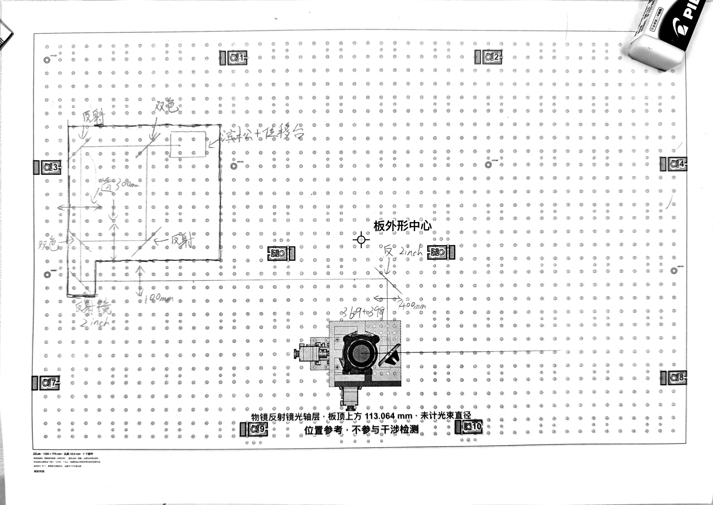
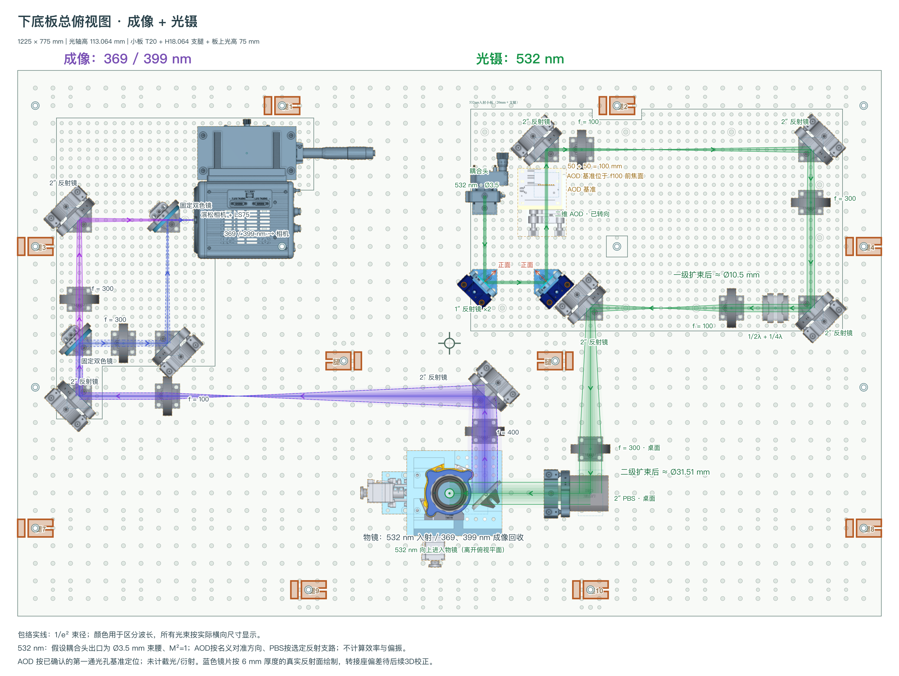
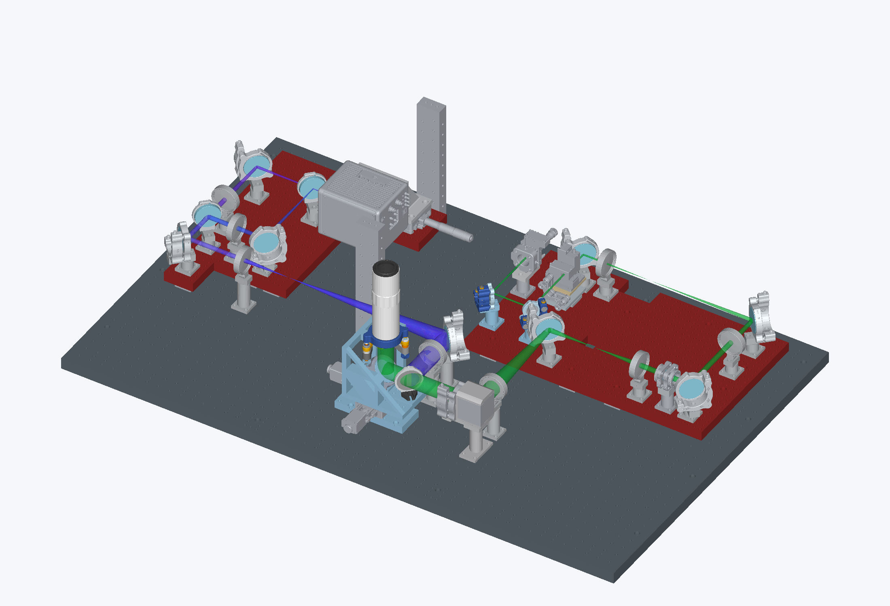

# From hand sketch to a lower-board assembly

[中文](workflow-case-study.md) · [Homepage](../README.md#sketch-to-3d)

This case follows the imaging and optical-tweezers project developed on 4–5 November 2026. The photographs and renders are existing project artifacts. They show successive engineering stages, with the later 532 nm path added after the initial imaging sketch. The full imaging project and its custom CAD dependencies are outside the curated three-example distribution.

## Interpreting the sketch

The researcher drew the imaging branch on a printed lower-board layout, marking the sub-board, mirrors, dichroics, lenses and camera branches. The first task was to turn that intent into explicit component choices and dimensions. Two-inch adjustable mounts were chosen for mirrors and two-inch fixed mounts for dichroics. An ambiguous handwritten focal length was confirmed as 100 mm rather than the initially read 180 mm.



The sketch supplied topology and constraints, not a complete manufacturing definition. The process included review of optical-face orientation and the camera reference, and later revisions to board support and clearance. No built-in handwriting-to-CAD converter is claimed by this example.

## Defining the project and checking its optics

The project uses the `zzlab-optics-project` format. It names registered kit IDs and stores instances in board-local coordinates, with rotations, parent-board IDs, selected post variants and optical settings. The R10 combined layout has 26 kit instances and a target optical height of 113.064 mm. A later request added the 532 nm input path on the right, including the existing 2D AOD model and compact dual-waveplate kit.

The f400/f100 imaging pair was moved to a 500 mm folded separation. On the right, the two blue mirrors were turned to expose the correct reflecting side. The agreed AOD reference—the first through-hole centre—was set 50 + 50 = 100 mm from the following f100 lens. The actual crystal interaction-plane offset remained unknown. Both f100/f300 relay pairs retained 400 mm folded separations.



The optical rendering recorded its assumptions. The imaging output was treated as a 36 mm waist at the stated reference. The 532 nm branch used a 3.5 mm waist and M²=1, with nominal aligned AOD behavior and the selected PBS reflection path. The displayed envelopes did not include AOD diffraction efficiency, clipping or measured polarization-dependent throughput. A drawn beam is therefore evidence of the modeled configuration, not a measured optical result.

The R10 preview still notes that the blue-mirror mechanical compensation was pending. The subsequent R11 CAD work addressed that item; the image was retained unchanged to make the stage distinction visible.

## Reconstructing the CAD assembly

The CAD stage reused the source device geometry and assembled each kit with its adapter, post and fasteners. Source-to-kit, kit-to-board and board-to-world transforms located the occurrences while preserving their hierarchy. Library dimensions were not scaled to make them fit a grid.

The right-hand module uses a 20 mm sub-board on eight 18.064 mm legs, with a 75 mm optical axis above its top surface. The height chain is:

```text
18.064 mm legs + 20 mm board + 75 mm local axis = 113.064 mm
```

This is measured from the lower-board surface. It illustrates why the 12.5 mm design module must not be used to round an actual system interface. Components mounted directly to the lower board use their corresponding explicit supports.



The three-dimensional review required a deeper board notch and moving one leg away from a frame column. Two blue mirror mounts also received 0.812637 mm compensation spacers so that the modeled 6 mm mirror reflecting surfaces returned to the intended datums. These are project-specific corrections, not universal adapter dimensions.

The recorded review covered the new module's 56 device mounting holes, 32 leg-base holes, optical height and checked static solid-interference scope, including the existing imaging/objective assembly. The R11 assembly manifest describes a static engineering assembly: `productionReady` is false and native mechanism-mate restoration is not claimed. A successful geometric check does not establish manufacturing approval, complete mechanism motion or the unknown optical properties.

## What makes the workflow repeatable

The useful handoff is a project definition connected to identifiable component records and model revisions. A later change starts by editing those sources, rebuilding the relevant output and checking the affected relationships. Image alignment alone is insufficient: real mounting holes, board transforms, optical faces, supports, clearances and access must stay consistent.

The repository supplies the component contract, layout and optical tools, CAD helpers and workflow instructions. Project-specific CAD rebuild scripts still have supported kits and transform assumptions that must be checked. Use the [JSON-to-3D workflow guide](../skills/zzlab-optics-json-to-3d/README.en.md) and [component design guide](../skills/hksop-component-design/README.en.md) for the relevant procedure.

The [image source manifest](assets/sources.json) records the original filenames, stages and SHA256 values. All five project images on the homepage were copied byte-for-byte from existing artifacts. No full historical assembly or delivery archive was added for this documentation update.
