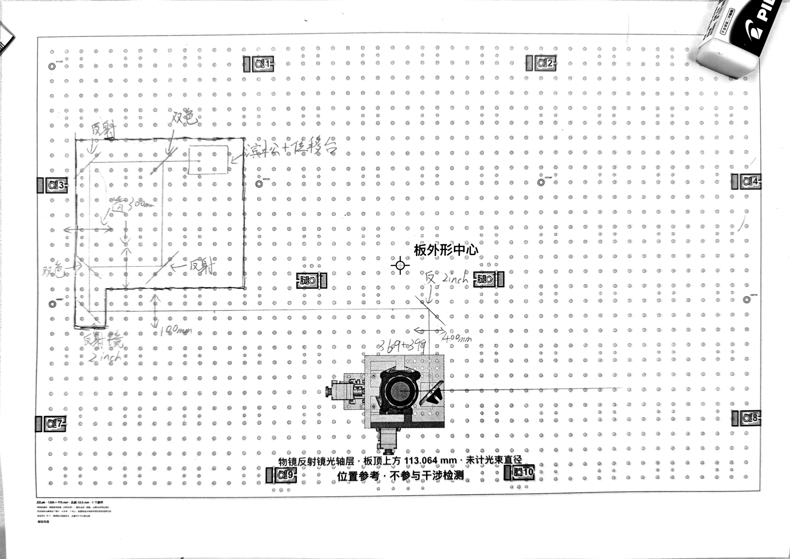
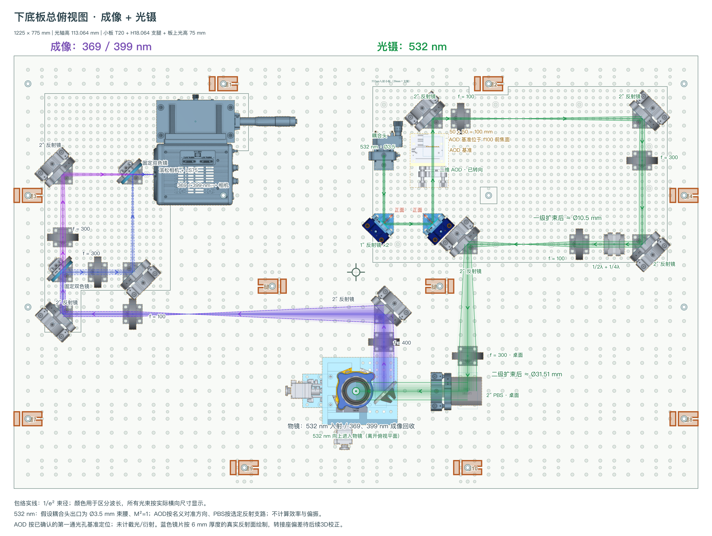
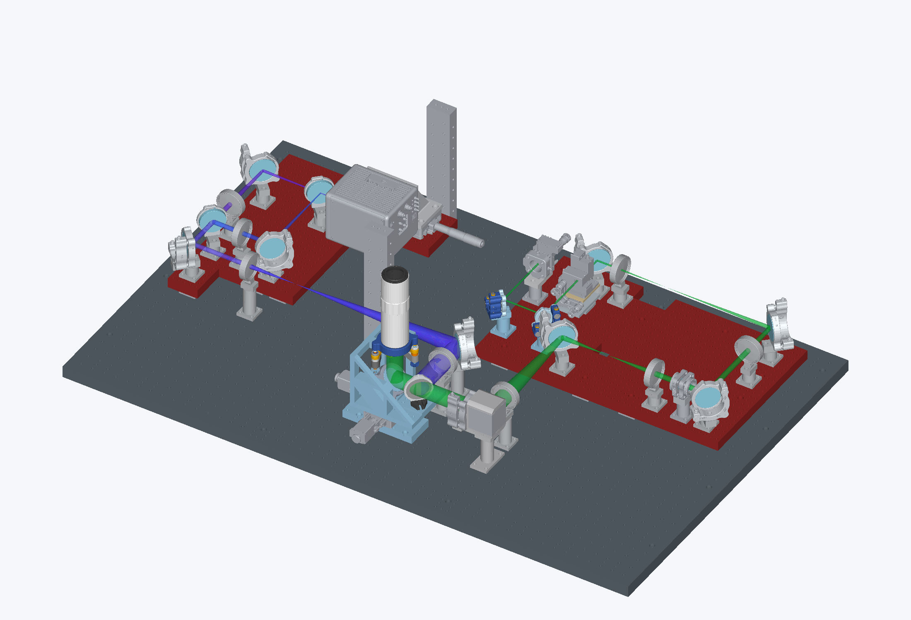

# 从手稿到下板三维总装

[English](workflow-case-study.en.md) · [返回首页](../README.md#sketch-to-3d)

本案例对应 2026 年 11 月 4—5 日完成的成像及光镊项目。图片来自实际留下的项目资料，展示的是连续迭代的不同阶段：最初只有成像手稿，后来增加右侧 532 nm 光镊支路，再完成三维机械修正。完整成像工程及其专用 CAD 依赖不在当前三个示例的精选分发范围内。

## 从实验意图确定元件与尺寸

研究者先在印好的下板孔位图上画出成像光路，标出小面包板、镜架、双色镜、透镜和相机支路。随后确认镜架类型和关键尺寸：反射镜用两英寸可调架，双色镜用两英寸固定架。入口透镜的手写标注曾被识别为 180 mm，经用户确认后按 100 mm 处理。



手稿提供光路拓扑和约束，工程所需的基准与安装细节在后续逐项确认。镜面正反、相机参考面、板的支撑结构和框架避让都经历过核对与修订。这个案例不代表仓库内置了直接从任意手写图生成 CAD 的转换器。

## JSON 布局与光路核对

项目使用 `zzlab-optics-project` 格式，以真实套件 ID 标识元件，保存板内坐标、转角、父板、万能柱选择和光学设置。合并后的 R10 有 26 个套件实例，目标光高为 113.064 mm。右侧 532 nm 支路来自后续设计要求，采用已有二维 AOD 模型和紧凑双波片套件。

成像支路的 f400/f100 透镜调整为 500 mm 折叠间距。右侧两片蓝色反射镜修正了正面朝向；AOD 按用户确认的“第一通光孔中心”定位，到后方 f100 透镜的距离为 50 + 50 = 100 mm。晶体实际作用面相对这个基准的偏移仍未知。两组 f100/f300 保持各自 400 mm 的折叠间距。



光束图带有明确假设：成像出口参考面按直径 36 mm 的束腰处理，532 nm 按直径 3.5 mm 束腰、M²=1、AOD 名义对准和 PBS 选定反射支路处理。图中没有计算 AOD 衍射效率、截光和实测偏振透过率，因此光束包络属于所建模型的结果，并非实测性能。

R10 图中仍注明蓝色镜座的机械补偿待完成。随后 R11 三维阶段处理了这项问题；本次保持原图不变，让读者能分清两个阶段。

## 三维复建与机械修正

三维阶段沿用器件源模型，将器件、转接件、万能柱和紧固件组成套件子装配，通过“源模型到套件、套件到小板、小板到总装”的变换放置各实例，保留内部层级。厂家几何没有为了凑网格而缩放。

右侧小板厚 20 mm，使用八根 18.064 mm 支腿，板上光高 75 mm。相对下板顶面的高度关系为：

```text
18.064 mm 支腿 + 20 mm 小板 + 75 mm 板上光高 = 113.064 mm
```

这个例子说明，12.5 mm 是常用几何模数，实际系统给定的光学接口高度仍应精确记录。直接装在下板上的器件使用对应的明确支撑尺寸。



三维核对发现小板缺口需要加深，一根支腿需要避开框架立柱；两片蓝色镜架还增加了 0.812637 mm 补偿垫环，使所建 6 mm 厚镜片的反射面回到指定基准。这些是本项目的修正尺寸，不能当作所有转接件的通用尺寸。

记录中的核对范围包括新增模块的 56 个器件安装孔、32 个支腿底孔、光高和所检查的静态实体干涉，也检查了与既有成像和物镜总成的关系。R11 装配清单的 `productionReady` 为 false，未声明恢复原生机构运动配合。几何核对通过并不意味着制造已经放行，也不补足尚未知晓的光学参数。

## 怎样让下一次修改可以继续

可复用的交接包括项目定义、元件记录、模型修订和核对范围。下一次修改从这些源定义出发，重建受影响的输出，再核对真实孔位、板层变换、光学面、支撑、干涉和操作空间。图片只是可视化的入口。

仓库提供协议、布局与光学工具、CAD 辅助和流程规范；具体复建脚本仍有适用套件和板层范围，使用前要核对。流程见 [JSON 到三维规范](../skills/zzlab-optics-json-to-3d/SKILL.md)及[元件设计规范](../skills/hksop-component-design/SKILL.md)。

[图片来源清单](assets/sources.json)记录原始文件名、阶段及 SHA256。本次首页使用的五张项目图片均为既有文件的原样复制，没有为展示引入历史三维总装或整套交付压缩包。
